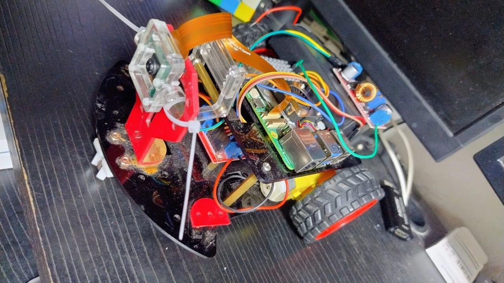
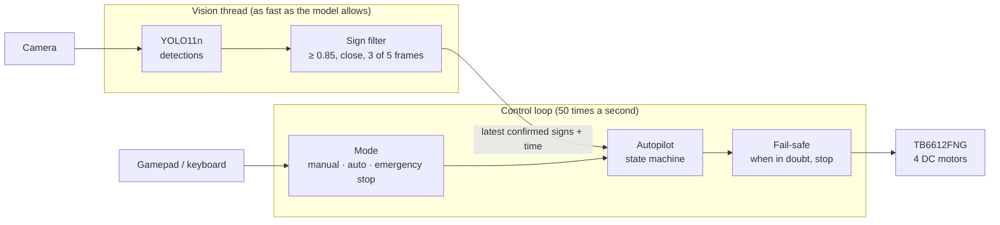
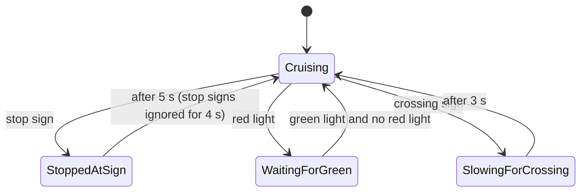
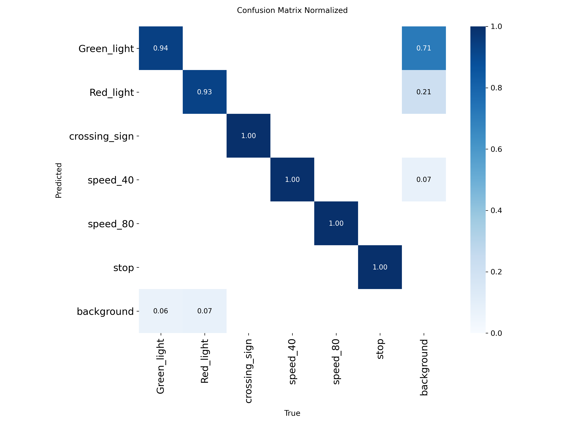

# Traffic Sign Car

[](https://github.com/rjrnova18-debug/traffic-sign-car/actions/workflows/ci.yml)

A small four-wheel car with a **Raspberry Pi 5** and a camera that recognizes traffic signs with a **YOLO11n** model and obeys them:

| Sign | What the car does |
|---|---|
| Stop | Stops for 5 seconds, then drives on |
| Red light | Stops until it sees the green light |
| Speed limit 40 / 80 | Changes its cruise speed |
| Pedestrian crossing | Slows down for a few seconds |

A wireless gamepad drives it by hand and switches between manual and autonomous mode.

<p align="center"></p>

I built the car in May 2025, but the code that ran on the Pi was lost. This repo rebuilds it from what survived (the training script, the trained model and a motor test, all kept in [`legacy/`](legacy/)) and makes it sturdier: stronger filtering against false detections, fail-safe stops, a PC simulation, 167 tests and CI.

## How it works

Two loops run at different speeds. The model needs about 150 ms per frame on the Pi, but the gamepad must answer within 20 ms, so the control loop never waits for the model: it uses the latest result, and stops the car if that result gets too old.



In auto mode the car drives straight and the **autopilot** only chooses the speed:



Speed limit signs change the cruise speed in any state.

## The model

[YOLO11n](https://docs.ultralytics.com/models/yolo11/), the smallest YOLO11, fine-tuned on a dataset I labeled in Roboflow: 6 classes, about 580 labeled signs. It was trained for 60 epochs at 640 px in Google Colab ([`training/train_detector.py`](training/train_detector.py)). One model finds the signs **and** tells them apart: the color of a traffic light and the number on a speed limit sign are classes of their own.

| | YOLO11n (used) | YOLOv8s |
|---|---|---|
| Size | 5.4 MB | 22.5 MB |
| Recall: green / red light | 0.94 / 0.93 | 0.94 / 0.93 |
| Recall: crossing, 40, 80, stop | 1.00 | 1.00 |

Both models were trained on the same data and scored almost the same, so the car uses the one that is 4 times smaller.

<p align="center"></p>

The confusion matrix shows the model's real weakness: most of its false alarms are **background seen as a green light** (71 % of them). That is why a single frame is never enough to act:

- **Confidence ≥ 0.85.** In the precision–confidence curve of the first version of the model, precision reaches 1.0 around 0.85–0.92 ([curve](docs/images/precision_confidence_v1.png)).
- **The sign must be close:** its box must be at least 12 % of the frame's height.
- **3 of the last 5 frames:** a sign is confirmed only when it is trusted in 3 of the last 5 frames.
- **A green light only counts with no red light confirmed at the same time.**

## Safety

| Situation | What the car does |
|---|---|
| Emergency button | Stops, and stays stopped until the button is pressed again (then manual mode) |
| Gamepad switched off or out of range | Stops and goes back to manual mode |
| Vision frozen or crashed (auto mode) | Stops when the latest result is older than 1 s; manual driving keeps working |
| Program stopped (Ctrl+C, error, `kill`) | Motors are always stopped on the way out |
| Stop sign still visible after the 5 s stop | Ignored for 4 s, so the car does not stop forever |

## Hardware

- Raspberry Pi 5 (4 GB) and the Raspberry Pi camera module
- TB6612FNG dual motor driver and 4 DC motors: the two left motors share channel A, the two right ones channel B (the car steers like a tank)
- A generic wireless gamepad with a 2.4 GHz USB receiver
- A battery and a buck converter for the Pi

| TB6612FNG | Raspberry Pi (BCM) |
|---|---|
| AIN1, AIN2, PWMA (left) | GPIO 17, 18, 22 |
| BIN1, BIN2, PWMB (right) | GPIO 23, 24, 25 |
| STBY | 3.3 V (or a GPIO: set `standby_pin`) |

The right motors are mirrored, so the right side goes forward with BIN2 high. [`config.py`](src/signcar/config.py) handles that by swapping its pins; if a side spins the wrong way on your car, swap them back. The motors are driven with **gpiozero**, because the original RPi.GPIO library does not work on the Raspberry Pi 5.

## Run it on a PC (simulation)

The webcam replaces the car's camera, the motors are simulated (two bars in the HUD) and the keyboard replaces the gamepad. Hold a phone with pictures of signs in front of the webcam.

```bash
python -m venv venv
source venv/Scripts/activate      # Windows (Git Bash). On macOS/Linux: source venv/bin/activate
pip install -r requirements.txt -r requirements-dev.txt
pip install -e .                  # creates the `signcar` command
signcar --sim                     # or: signcar --sim --source video.mp4
```

| Key | Action |
|---|---|
| W / S | Forward / backward |
| A / D | Turn left / right |
| M | Manual ↔ auto |
| Space | Emergency stop (press again to release) |
| Q / Esc | Quit |

> On Windows, PyTorch needs [long paths enabled](https://pip.pypa.io/warnings/enable-long-paths) if the project lives in a deep folder.

## Run it on the car (Raspberry Pi 5)

```bash
git clone https://github.com/rjrnova18-debug/traffic-sign-car.git && cd traffic-sign-car
python3 -m venv --system-site-packages venv   # picamera2 and gpiozero come from Raspberry Pi OS
source venv/bin/activate
pip install -r requirements-pi.txt && pip install -e .

signcar --test-motors      # wheels in the air: each side spins both ways
signcar --probe-gamepad    # find your gamepad's stick and button numbers
signcar                    # drive (add --record run.mp4 to film the HUD)
```

## Project structure

```
src/signcar/
├── config.py      every number the car uses (pins, thresholds, speeds, times)
├── signs.py       signs, detections and the filter that decides which to believe
├── autopilot.py   the state machine that sets the speed in auto mode
├── driving.py     modes, tank-style mixing and the fail-safe
├── detector.py    YOLO11n → detections (the only module that imports ultralytics)
├── camera.py      Pi camera (picamera2) or webcam / video (OpenCV)
├── motors.py      TB6612FNG (gpiozero) or simulated motors
├── gamepad.py     the wireless gamepad (pygame-ce)
├── keyboard.py    keyboard controls for the simulation
├── hud.py         the HUD drawn over the camera image, and its recording
├── app.py         the vision thread and the control loop
└── __main__.py    the `signcar` command
```

`config`, `signs`, `autopilot` and `driving` are plain Python: they decide everything, and a test makes sure they never import hardware or model libraries. That is why the CI runs every test in about a second without a camera, a GPU or a Raspberry Pi.

## Tests

```bash
pytest
ruff check . && ruff format --check .
```

The motor driver is tested on gpiozero's simulated pins, and the control loop with fake controls, cameras and models.

## What I learned

- **Separating decisions from hardware.** The autopilot doesn't know there is a camera, and the motors don't know there is a model. Every rule of the car can be tested in milliseconds on any computer.
- **Concurrency with a purpose.** A slow producer (the model) and a fast consumer (the controls) share only "the latest result and when it was made", protected by a lock.
- **Designing for failure.** Every unknown (a lost gamepad, stale vision, a crash) ends in the same safe state: stopped.
- **Reading a model's metrics before trusting it.** The confusion matrix pointed straight at the false green lights, and the filter was designed around them.
- **State machines with an injected clock.** Tests jump 5 seconds ahead instantly instead of sleeping.
- **Keeping secrets out of git.** The training script reads the API key from an environment variable.

## Possible improvements

- Export the model to NCNN, the format Ultralytics recommends for the Raspberry Pi, for 2 to 4 times more frames per second.
- Steer in auto mode by following a line or the lane.
- Start the program automatically when the car is switched on (a systemd service).
- A minimum box size per sign, since traffic lights and signs have different shapes.

## License

[AGPL-3.0](LICENSE), because the model was trained and runs with [Ultralytics](https://github.com/ultralytics/ultralytics), which is AGPL-3.0.
